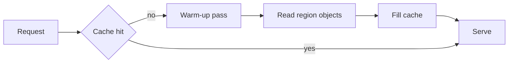

# Cache warm-up experiment

The change adds a region-scoped warm-up pass before the first request. Three regions improved, one regressed.

## Method

Each region ran the same synthetic workload twice: once cold, once after the warm-up pass. Latency is the median of 200 requests.

::: note What this does not measure
Only the happy path. Timeouts and partial cache fills were not exercised.
:::

## Results

| Region | Cold p50 | Warm p50 | Change |
|---|---:|---:|---:|
| us-east | 210 ms | 96 ms | −54% |
| eu-west | 188 ms | 91 ms | −52% |
| ap-south | 305 ms | 268 ms | −12% |
| sa-east | 240 ms | 291 ms | **+21%** |

::: warn Regression in sa-east
The warm-up pass reads more objects than the cold path for small regions, so it pays a serialization cost it never amortizes.
:::

## Where the time goes

## Conclusions

- Three regions gained more than 40%.
- One region lost a fifth of its latency budget.
- The warm-up pass should be gated on region size.

## Next step

Gate the pass on measured object count per region, then re-run the same workload.
