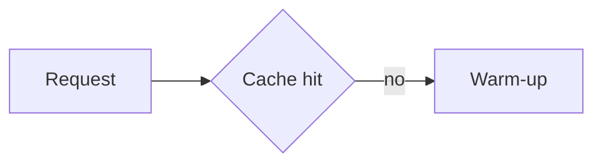

# Report format

The renderer accepts a deliberate subset of Markdown. Everything here is
supported; anything else is reported as a problem rather than rendered
approximately, so a report never silently loses a construct.

## Frontmatter

Optional, and only at the top of the file. Flat scalar fields:

```markdown
---
title: Cache warm-up experiment
subtitle: First measurement, four regions
date: 2026-11-02
status: draft
source: examples/report.md
---
```

| Field | Rendered as |
|---|---|
| `title` | Page `<title>`, the `h1`, and the sidebar brand. Falls back to the first `#` heading, then the filename. |
| `subtitle` | A line under the `h1`. Omit it rather than write a second title. |
| `date` | A plain string in the header meta. Not reformatted — write the form you want to read. |
| `status` | A badge in the header meta (`draft`, `reviewed`, `final`). |
| `source` | Provenance text in the footer: the run, the commit, the input path. |
| `audience` | Who reads it (`Engineering lead deciding whether to fund the fix`). Shown in the hero and used to pick the register. |
| `decision` | The ask, in one sentence. Rendered as a bordered panel under the title. `--detailed` only. |
| `lede` | The one-sentence answer, set larger under the title. `--detailed` only. |
| `register` | `paper`, `instrument`, `blueprint`, or `editorial`. Overrides the inferred register. |

Only flat `key: value` lines are read. A nested structure, an anchor, or a
multi-line value is ignored.

## Blocks

```markdown
# h1 — dropped from the body; it becomes the page title
## h2 — a section, and a sidebar entry
### h3 — a subsection, and a sidebar entry
#### h4 — rendered, not in the sidebar

A paragraph. **Bold**, *italic*, `code`, [a link](other.md), and bare URLs in
angle brackets.

- a bullet
  - a nested bullet (two-space indent, one level deep)
1. an ordered item

> A blockquote.

| Column | Right |
|---|---:|
| a cell | 42 |

```js
fenced code, escaped, never executed
```

---
```

Rules:

- **Headings.** The body `h1` is dropped: the header already carries the title.
  `h2` and `h3` become sidebar entries; deeper headings render but stay out of
  the rail.
- **Links to `.md`** are rewritten to `.html`, so a rendered report can link to
  another rendered report. External links open in a new tab.
- **Tables** need a header row and a `---` separator. Alignment comes from the
  colons. Escaped `\|` stays inside the cell.
- **Lists** nest one level. A continuation line that is not a new bullet is
  joined onto the item above it.
- **No raw HTML.** It is escaped, not passed through. Use a callout instead.

## Figures

An image on its own paragraph becomes a numbered figure, and the number is what
the sidebar's evidence shelf links to:

```markdown

```

- The alt text is the caption. Add a `"title"` to override the caption:
  ``.
- The **folder** the image lives in becomes its shelf group. Images in
  `evidence/screenshots/**` group under `evidence`; a different top folder gets
  its own heading in the shelf.
- Paths resolve relative to the Markdown file. A missing file is a build
  failure with a line number, never an empty box.
- The same image referenced twice is stored once.
- Remote URLs are not downloaded. They are reported, because the page has to
  open offline.

## Callouts

```markdown
::: note What this does not measure
Only the happy path.
:::
```

`note` (default), `warn`, or `good`. The first line after the marker is the
title; the rest is body text. Close with a bare `:::`.

Use one where a reader must not miss a caveat. Three callouts on a page is
already too many.

## Metrics

```markdown
::: metrics
- 7 | Findings | four at SEV 3
- 2.85:1 | Retention note contrast | floor is 4.5:1
:::
```

`value | label | note`. One card per line, laid out across the full content
width. A signed percentage in the note draws a bar whose length is the
magnitude and whose colour is the direction.

Use a metric block when the numbers are the argument. Four cards is a row; nine
is a dashboard nobody asked for.

## Quotes and comparisons

```markdown
::: quote F1, finding summary
Every control is styled as if it were the primary action.
:::
```

The first line is the attribution, the body is the quote, set in a display
serif with a rule.

```markdown
::: compare
 | 
:::
```

Two to four images side by side, each a numbered figure with its alt text as
the caption, each in the evidence shelf. Use it for a before and after, or for
options under discussion.

## Tables that carry status

With `--detailed`, a cell whose whole value is one of `pass`, `ok`, `yes`,
`done`, `fail`, `error`, `no`, `blocked`, `warn`, `pending`, or `skipped` is
rendered as a status chip. Anything else stays text. The vocabulary is fixed so
a report cannot invent a hundred colours.

## Diagrams

A fenced `mermaid` block is rendered to an SVG at build time and embedded as a
real image — the page ships no diagram JavaScript:

````markdown

````

Build-time rendering needs a headless browser and the vendored Mermaid build.
Set `HTML_REPORT_CHROMIUM` and `HTML_REPORT_MERMAID` to override either. A
diagram that fails to parse fails the build with its line number.

Pre-rendered images work too: an exported `.svg` or `.png` becomes a figure
like any screenshot. Prefer an image when the diagram is the evidence; prefer a
`mermaid` fence when the diagram is a description that may need editing.

## Output

```bash
node render-report.mjs report.md                 # -> report.html, everything inlined
node render-report.mjs report.md --detailed      # -> the editorial layout
node render-report.mjs report.md --folder        # -> report-report/index.html + assets/
node render-report.mjs report.md --out dist/r.html
```

### `--detailed`

Turns the page from a document into an argument. It adds a hero that states the
audience and the ask, a standfirst, numbered sections, status chips, metric
cards, pull quotes, and side-by-side comparisons — and it picks a **register**,
a visual voice, from the stated audience:

| Register | Voice | Chosen when the audience reads as |
|---|---|---|
| `paper` | Serif headings, warm paper, quiet rules | nothing in particular — the default |
| `instrument` | Cool greys, mono labels, dense numerals | engineering, review, audit, incident |
| `blueprint` | Blue-tinted, dashed frames, mono eyebrows | architecture, design, systems |
| `editorial` | Display serif, drop cap, italic standfirst | a decision, exec, board, stakeholder |

Read `audience` first, `register` second: naming the reader is the point, and
the override exists for when the inference is wrong. Every register is built
from system fonts, so the offline rule still holds.

Use `--detailed` when the report has a decision to drive. Skip it for a
reference page that will be looked up, not read through.

- **Single file** (default) inlines every asset as a data URI. It survives being
  moved, mailed, or served from a path other than where it was built, which is
  how reports actually get read. Assets over 12 MB are copied instead and
  reported.
- **Folder mode** (`--folder`) keeps assets as real files: diffable, openable at
  full size, cheap to re-read, and the right choice for a large evidence set.
  It only renders correctly when the `assets/` directory stays beside
  `index.html` — a viewer that serves the page from another base URL will show
  broken images.
- Asset filenames are the original stem plus a hash of the bytes, so the same
  screenshot keeps the same name across reports and rebuilds.

The build prints one summary line and one `problem:` line per issue, and exits
non-zero when any reference is unresolved. A page is still written on failure,
so a broken build leaves something to look at.

In-page links — the sidebar outline, the evidence shelf, figures — carry real
`#id` hrefs and are also handled by the page's small script. That second path
matters: a viewer that injects a `<base>` element resolves a bare `#id` against
its own URL, so the native jump navigates away instead of scrolling. Both paths
land on the same anchor.

## Determinism

The same Markdown, assets, and options produce byte-identical output. There are
no timestamps, no run ids, no random ordering, and no environment-dependent
paths in the page. Two builds that differ mean the input changed.
